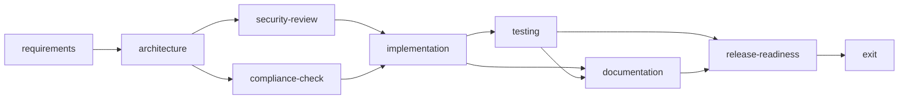

# Agentic URL Shortener

This project is a Spring Boot-based URL shortener prototype designed to demonstrate an agentic SDLC workflow, governed autonomy, and reliability features.

## Requirements interpretation

The project translates the interview assignment into a clear engineering problem:

- Build a production-style URL shortener service in Java with Spring Boot.
- Include redirect logic, persistent storage, and analytics collection.
- Implement an orchestration layer that models stage gates, approval checkpoints, retries, rollback, and traceability.
- Demonstrate greenfield, brownfield, and ambiguous-requirement scenarios in a reviewable form.
- Produce working code, tests, and documentation suitable for review.

## Architecture overview

### Core components

- URL service layer for creation, validation, and redirect handling
- JPA-backed persistence using H2 for in-memory development data
- Analytics service that tracks click counts and recent visit metadata
- Agentic orchestration service with graph-based workflow staging
- REST API layer for integration and demonstration

### Workflow graph and control flow



The workflow service enforces dependency gates on state-changing requests. The demo begins with requirements and architecture completed; security review and compliance start pending and block implementation until each is explicitly approved and completed. Implementation and release readiness also require human approval before execution. Testing and documentation can proceed once their dependencies complete. A stage moves through approval (when required), start, and completion; failed stages have a three-retry limit. Rollback blocks all transitive dependents, while re-planning records a new context version and resets the selected stage and its dependents. An operator can choose an alternate fallback strategy after a failure or rollback; the retry budget remains consumed, and the fallback still passes through the normal approval gate. Those mechanisms keep the demo inspectable and provide safe-stop behavior when work is invalidated.

The workflow API exposes its decision history at `/api/v1/orchestration/audit`. Entries include timestamp, action, stage, state, actor label, and detail/context version. Metrics are derived from the current in-memory run: completion/approval percentage, retry and rollback counts, observed recovery time, and elapsed time since service initialization.

This is a controlled orchestration model, not a connected LLM-agent runtime: the service does not execute code or external agents. "operator" is an unauthenticated actor label for this local prototype, and workflow/audit data is in-memory and is lost on restart. Production deployment requires durable audit storage, authenticated authorization for approvals, distributed locking, and externally measured service-level metrics.

### Main API endpoints

- POST /api/v1/links
- GET /api/v1/links/{shortCode}
- GET /api/v1/links/{shortCode}/stats
- GET /api/v1/analytics/summary
- GET /api/v1/orchestration/workflow
- GET /api/v1/orchestration/scenarios
- POST /api/v1/orchestration/stages/{stageId}/approve
- POST /api/v1/orchestration/stages/{stageId}/retry
- POST /api/v1/orchestration/stages/{stageId}/rollback

## Operational model

The orchestration layer follows an explicit dependency graph with entry and exit gates:

1. Requirements
2. Architecture
3. Security Review
4. Compliance Check
5. Implementation
6. Testing
7. Documentation
8. Release Readiness
9. Exit

This graph supports sequential and parallel work by modeling stage dependencies and approval checkpoints. It also exposes retrial and rollback controls, plus operational reliability metrics such as success rate, retry frequency, rollback count, MTTR, and latency.

## Three scenario examples

### 1. Greenfield

- Capture the product intent and normalize it into a clear engineering scope.
- Design the service contract, entity model, and redirect flow.
- Implementation passes through security, testing, documentation, and release readiness gates.

### 2. Brownfield

- Extend an existing shortener with metrics and observability without breaking the redirect contract.
- Run compatibility checks and rollback planning before rollout.
- Use the dependency graph to manage change control and human approval.

### 3. Ambiguous requirements

- Clarify alias and expiration policy decisions before implementation.
- Add governance checkpoint to resolve policy guardrails.
- Re-plan if product constraints change and safe-stop when approval is missing.

## Setup instructions

1. Ensure Java 17 and Maven are installed.
2. Run the application:
   `mvn spring-boot:run`
3. The app will start on http://localhost:8080.
4. Use the H2 console at http://localhost:8080/h2-console with JDBC URL `jdbc:h2:mem:urlshortener`.

## Testing

The suite contains focused service/workflow unit tests and Spring MVC integration tests covering the HTTP contracts and orchestration gates. Run:

```powershell
mvn test
```

The tests validate:

- URL validation, alias handling, conflicts, and code generation
- Redirect resolution, click tracking, and visit metadata
- Per-link statistics and the analytics summary
- Orchestration dependencies, approval gates, retries, and rollbacks
- Context re-planning, audit history, and retry-limit enforcement
- HTTP link creation, redirect, statistics, invalid input, and orchestration behavior
- Spring application startup and end-to-end service wiring

## API examples

Start the application with `mvn spring-boot:run`. The examples below assume `http://localhost:8080`.

### Create a short link

```http
POST http://localhost:8080/api/v1/links
Content-Type: application/json
```

Sample body:

```json
{
  "url": "https://example.com/articles/getting-started",
  "alias": "start_here"
}
```

`alias` is optional. If omitted, the service generates an eight-character code. Custom aliases must be 4-20 letters, digits, underscores, or hyphens.

PowerShell/curl example:

```powershell
curl.exe -X POST http://localhost:8080/api/v1/links `
  -H "Content-Type: application/json" `
  -d '{"url":"https://example.com/articles/getting-started","alias":"start_here"}'
```

### Redirect and analytics

Use the `shortCode` returned by link creation (or `start_here` for the example above):

| Method | URL | Purpose |
| --- | --- | --- |
| GET | `http://localhost:8080/api/v1/links/start_here` | Resolve the link; returns HTTP 302 and records a visit |
| GET | `http://localhost:8080/api/v1/links/start_here/stats` | Return click count and up to 10 recent visits |
| GET | `http://localhost:8080/api/v1/analytics/summary` | Return totals and the most visited links |

To follow redirects from the command line, use `curl.exe -i http://localhost:8080/api/v1/links/start_here`; `-i` shows the 302 response and `Location` header.

### Orchestration endpoints

| Method | URL | Purpose |
| --- | --- | --- |
| GET | `http://localhost:8080/api/v1/orchestration/workflow` | Inspect workflow stages, dependencies, gates, and metrics |
| GET | `http://localhost:8080/api/v1/orchestration/scenarios` | List greenfield, brownfield, and ambiguous scenarios |
| GET | `http://localhost:8080/api/v1/orchestration/audit` | Inspect decision and action lineage |
| POST | `http://localhost:8080/api/v1/orchestration/stages/implementation/approve` | Record required human approval |
| POST | `http://localhost:8080/api/v1/orchestration/stages/implementation/start` | Start an eligible, approved stage |
| POST | `http://localhost:8080/api/v1/orchestration/stages/implementation/complete` | Complete an in-progress stage |
| POST | `http://localhost:8080/api/v1/orchestration/stages/implementation/fail` | Mark an in-progress stage failed |
| POST | `http://localhost:8080/api/v1/orchestration/stages/implementation/retry` | Queue a retry (maximum 3 per stage) |
| POST | `http://localhost:8080/api/v1/orchestration/stages/implementation/fallback` | Select an alternate recovery strategy |
| POST | `http://localhost:8080/api/v1/orchestration/stages/implementation/rollback` | Roll back a stage and block dependents |
| POST | `http://localhost:8080/api/v1/orchestration/stages/architecture/replan` | Update context and reset downstream stages |

The approval, start, complete, retry, and rollback endpoints do not require a body. To reach implementation in the initial workflow, approve, start, and complete both `security-review` and `compliance-check` first; those two gates can be worked in parallel. The failure endpoint accepts `{"reason":"Contract test failed"}`, fallback accepts `{"strategy":"Use a read-only persistence adapter"}`, and re-planning accepts `{"context":"Add a 30-day visit retention requirement"}`. Stage changes that are premature, unsafe, or violate retry limits return HTTP 409. Invalid request bodies return HTTP 400.

## Risks and trade-offs

- An in-memory H2 database is used intentionally for a prototype and should be replaced with PostgreSQL or MySQL for production.
- The orchestration workflow is an explicit in-memory control plane, not an autonomous agent framework or durable job runner.
- Workflow audit identity is a demo label, not authenticated identity; secure approvals and persistent tamper-resistant audit storage are needed before production.
- Retry, rollback, and re-planning update workflow state but do not run a build, deploy, or restore application data.
- Reliability metrics are derived from this process's workflow state; they are not production telemetry or SLO measurements.

## Final assumptions and limitations

- Human approval is recorded by API calls; no identity provider, approval notification, or policy engine is connected.
- The prototype demonstrates controlled orchestration rather than autonomous agent execution.
- Workflow state and metrics reset on application restart; use a durable database and a monitoring system for production.
